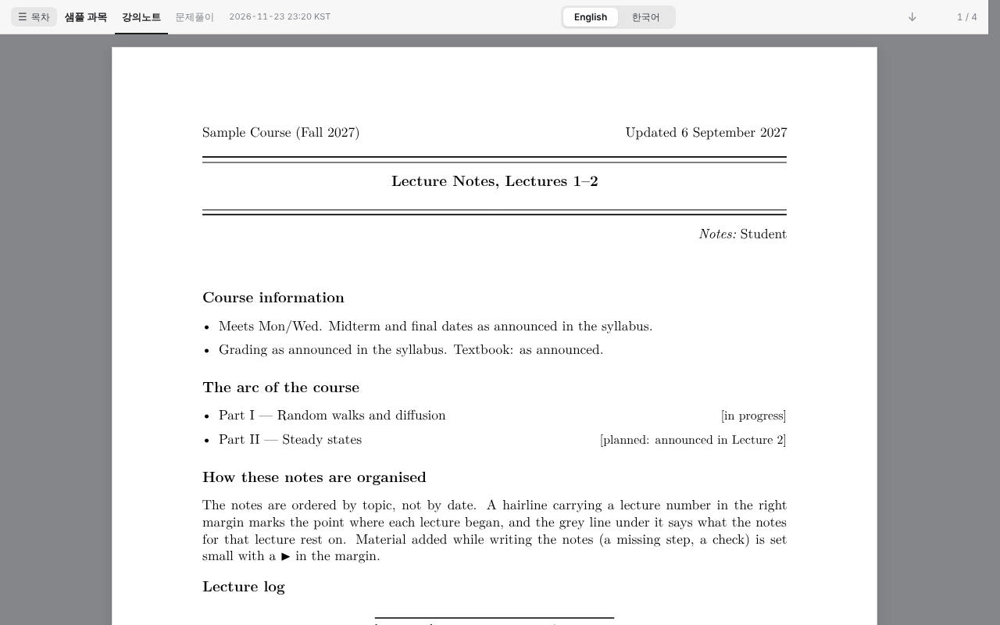
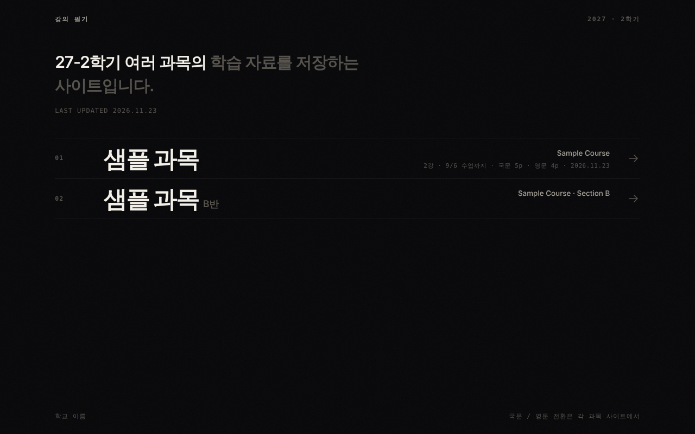
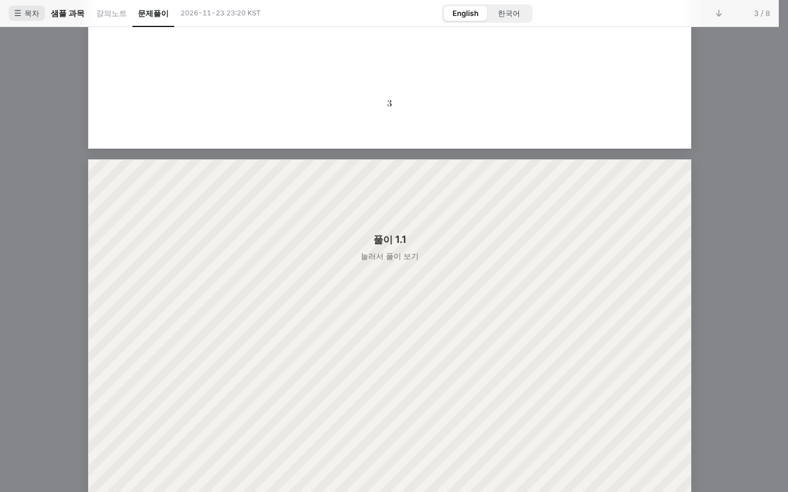
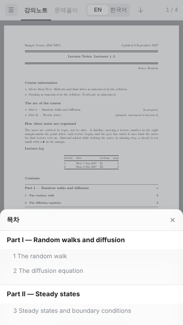
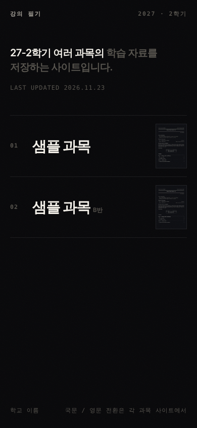

# course-notes-skills

**수업 자료를 받아 한·영 강의노트를 쓰고, 웹 뷰어와 과목 허브로 게시하고, 시험 대비 자료까지 만드는 Claude 스킬 모음.**
**Claude skills that turn a student's course material into bilingual lecture notes, publish them on the web, and build exam preparation from them.**

<p align="center">
  
  
</p>
<p align="center">
  
  
  
</p>

한 학생이 한 학기 동안 아홉 과목(물리, 공학, 실험)의 강의노트를 Claude와 함께 만들면서
정해진 방식을 그대로 옮긴 저장소입니다. 학생이 자료를 어떻게 주었는지(맥의 과목 폴더,
채팅 업로드, 유튜브 녹음, 시험지 사진, 예년도 zip, OCR된 교재), 노트를 어떤 구조와
규칙으로 쓰는지, 뷰어가 왜 그렇게 동작하는지, 허브·문제집·치팅시트·과제 답지를 어떤
형식으로 만드는지, 맥과 어떻게 동기화하는지까지 모두 적었고, 각 스킬에는 바로 쓸 수
있는 템플릿과 스크립트, 자동 시험이 들어 있습니다.

강의 자료·녹음·시험지·교재·실제 노트 내용·사람 이름은 하나도 들어 있지 않습니다. 예시는
전부 지어낸 "샘플 과목"입니다.

## 스킬 / Skills

작업 순서대로 / in the order a term uses them:

| # | 스킬 | 하는 일 | What it does |
|---|---|---|---|
| 1 | [`bilingual-lecture-notes`](skills/bilingual-lecture-notes/SKILL.md) | 자료 받기·읽기, 주제 순서 노트(한·영 같은 번호), LaTeX 스타일, 그림, 국문판 규칙, 빌드·게시, 보고 형식 + 강좌 템플릿 | intake of every kind of material, topic-ordered notes in two editions with identical numbering, style, figures, Korean-edition rules, build and publish, the report; a course template |
| 2 | [`pdf-notes-viewer`](skills/pdf-notes-viewer/SKILL.md) | PDF 한 장짜리 웹 뷰어: 언어를 바꿔도 같은 절, 목차, 문서 탭, 풀이 가림, 읽던 자리 기억; 모든 동작과 그 이유, 고쳐 온 문제 18가지, 자동 시험 | a one-file PDF viewer: same section across languages, contents, document tabs, covered solutions, remembered places; every behaviour with its reason, 18 fixed glitches, an automated test |
| 3 | [`course-notes-hub`](skills/course-notes-hub/SKILL.md) | 학기 과목 목록 한 페이지: 각 과목의 강의 수·쪽수를 실시간으로, 미리보기, 링크 카드 | the one page listing a term's course sites with live counts, previews and a link card |
| 4 | [`exam-prep-materials`](skills/exam-prep-materials/SKILL.md) | 문제집(문제·풀이 번갈아, 사이트 탭), 과제 답지, 기출 답지, 모의고사, 치팅시트(자동 배치), 유도 총정리, 교재 연습문제, 채팅 설명 규칙과 수식 위젯 | problem books, homework answer sheets, past-exam keys, mock exams, packed cheat sheets, derivation summaries, textbook problems, explaining in chat with rendered math |
| 5 | [`student-mac-and-recordings`](skills/student-mac-and-recordings/SKILL.md) | 맥 과목 폴더(두 대의 맥, iCloud, NFD 이름), 결과물 넣기, 지우기 없이 git 번들로 노트 동기화, 녹음 받기와 받아쓰기 | the course folder on the Mac, delivering files, syncing the notes clone with a bundle, fetching and transcribing recordings |

각 폴더: `SKILL.md`(언제·무엇·단계·규칙·자체 점검), `references/`(자세한 설명), `assets/`(복사해 쓰는 코드와 템플릿, 시험).
Each folder: `SKILL.md` (when, what, steps, rules, self-check), `references/` (the detail), `assets/` (code and templates to copy, with tests).

처음이라면 [docs/START-HERE.md](docs/START-HERE.md)부터. 학생과 일하는 방식은 [docs/working-agreements.md](docs/working-agreements.md).
New here: start with [docs/START-HERE.md](docs/START-HERE.md); how the student and the agent worked together is in [docs/working-agreements.md](docs/working-agreements.md).

## 설치 / Install

Claude Code:

```text
/plugin marketplace add suhan-dev/course-notes-skills
/plugin install course-notes@course-notes-skills
```

또는 `skills/` 아래 폴더를 `~/.claude/skills/`(개인) 또는 프로젝트의 `.claude/skills/`에 복사합니다.
Or copy the folders under `skills/` into `~/.claude/skills/` or a project's `.claude/skills/`.
Other agents: read [AGENTS.md](AGENTS.md) and [llms.txt](llms.txt).

설치해서 잘 쓰고 계시다면 [저장소](https://github.com/suhan-dev/course-notes-skills)에 스타 하나 부탁드려요. /
If the install is working for you, a star on [the repository](https://github.com/suhan-dev/course-notes-skills) helps.

필요한 것 / Requirements: XeLaTeX with Korean support and the Nanum fonts (`skills/bilingual-lecture-notes/assets/course-template/tools/setup-container.sh` sets up a Debian/Ubuntu container), Python 3, Node 18+ with Playwright for the tests, poppler-utils, Ghostscript.

## 점검 / Checks

```bash
bash tools/privacy-scan.sh      # 개인정보·비밀값 검사, ✓만 나와야 함 / must print only ✓
python3 tools/check-skills.py   # 스킬 형식·링크·목록 / layout, links, lists
```

스킬별 시험 / per-skill tests: `pdf-notes-viewer/assets/test/viewer-test.js`,
`student-mac-and-recordings/assets/sync/test-sync.sh`,
`student-mac-and-recordings/assets/recordings/test-recordings.sh`, and the
builds in each `SKILL.md`'s self-check.

## 라이선스 / License

MIT. 이 저장소는 방법만 담습니다. 강의 자료는 강의하신 분의 것이므로 이 스킬로 만든 노트
저장소는 비공개로 두세요. / This repository holds the method only. Course material belongs to its
instructors: keep the notes repositories these skills produce private.

유용했다면 ⭐ 부탁드려요. / If these skills helped, a ⭐ on [the repository](https://github.com/suhan-dev/course-notes-skills) is appreciated.
