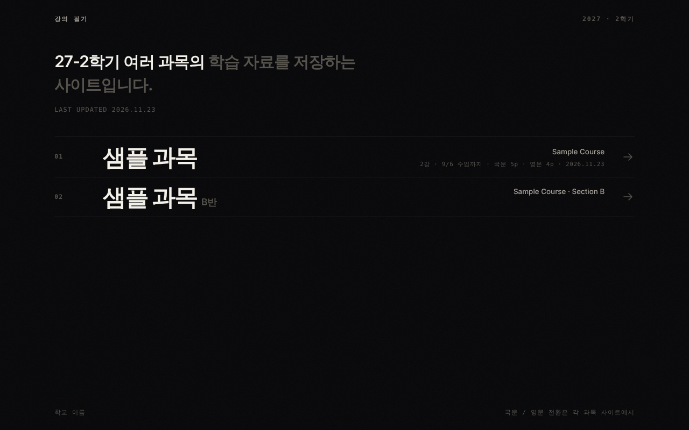
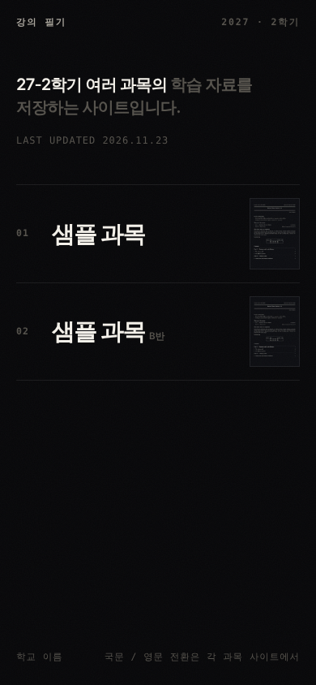

# Course-notes hub

One dark, editorial page at `<account>.github.io/<hub-repo>/` that lists every
course site of the term: a big course name per row, its English name, and a
live line such as `12강 · 11/16 수업까지 · 국문 112p · 영문 96p · 2026.11.21`
read from that course's `manifest.json`. On a desktop a preview of the notes'
title page follows the cursor; on a phone the preview sits in the row. Shared
in a messenger, it unfurls into a 1200×630 card made with LaTeX.

The student opens this page first, so it should answer at a glance "which
course was updated, and up to which class".

  
  

## When to use

- A new term: make the hub.
- A new course site exists, or a course is renamed or split into sections.
- The student wants the hub's wording, order or look changed.
- A thumbnail or the link-preview card is out of date.

## What you get

- `assets/index.html`: the page, with two sample rows.
- `assets/og-card.tex` → `og.jpg`: the link-preview card.
- `assets/make-thumb.py`: a course's title page → dark 700px JPEG thumbnail.
- `assets/thumbs/sample.jpg`, `assets/og.jpg`: what those produce for the
  sample course.

## Steps: a new hub

1. Create a repository (public or private; Pages from the root of `main`),
   copy `assets/index.html`, `og-card.tex`, `make-thumb.py`, and add
   `.nojekyll`.
2. In `index.html` replace `ACCOUNT` / `HUB-REPO` in the Open Graph and
   Twitter tags (they must be **absolute** URLs), the term in the title, rail,
   intro and description, and the school name in the footer.
3. Add one row per course (below), numbered 01, 02, … by hand.
4. Make the card: edit the term and course names in `og-card.tex`, then
   `xelatex og-card.tex && pdftoppm -r 72 -jpeg -jpegopt quality=90 -singlefile og-card.pdf og`.
5. Commit, push, check the Pages run.

## Steps: adding a course

1. Thumbnail: `python3 make-thumb.py <course>/Notes-EN.pdf thumbs/<course>.jpg`.
2. Row: copy a `<a class="row">` block; set `href` to the course site,
   `data-repo` to the course repository's name (the hub fetches
   `/<data-repo>/manifest.json` from the same origin), `data-thumb` and the
   `` to the thumbnail, the Korean name in `.name`, the
   English name in `.en`. Two sections of one course: add
   `<small class="prof">B반</small>` after the name (the right-hand column is
   hidden on phones, so the distinction must be in the name line).
3. Add the course to the card's list, rebuild `og.jpg`, and **raise `?v=`**
   on every `og:image` / `twitter:image` URL: messengers (KakaoTalk above all)
   keep a scraped preview for a long time.
4. Commit as `hub: <course> 추가` and push.

## Rules

- **No build step.** One HTML file, inline CSS and JS, one web font
  (Pretendard from jsdelivr). It must work if the font never loads.
- **The live line comes from the course manifests only**; the hub stores no
  dates or counts. A course site without a manifest (a site that is not a PDF
  viewer) simply shows no line.
- **All sites must be on the same origin** (`<account>.github.io`) for the
  plain `fetch('/<repo>/manifest.json')` to work. A site elsewhere needs CORS
  or no live line.
- **Thumbnails show the title page**, rendered dark to sit in the page. If
  the title page carries someone's name or e-mail (a TA on a lab handout),
  use a content page instead; never thumbnail the instructor's material.
- **Keep the motion calm and optional**: everything respects
  `prefers-reduced-motion`, and touch devices get no cursor preview.
- Course names and section labels are the student's wording; ask before
  renaming.

## Self-check

- [ ] Every row's `data-repo` matches a site whose `manifest.json` loads (the
      line appears) or is a site known to have none.
- [ ] `og:image` URLs are absolute and their `?v=` was raised after a card
      change.
- [ ] 1280px and 390px screenshots: no horizontal scroll, names fit, the
      stamp shows the newest date.
- [ ] Thumbnails are 700px wide, dark, legible.

## References

- [design.md](references/design.md): the look and every interaction, with
  the reasons; the manifest line; the link-preview card.
