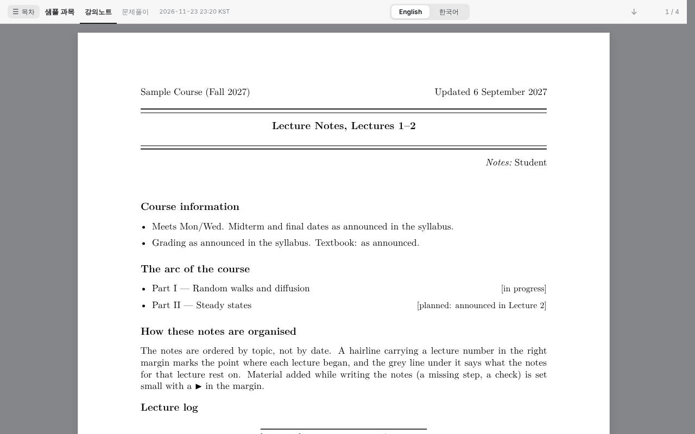
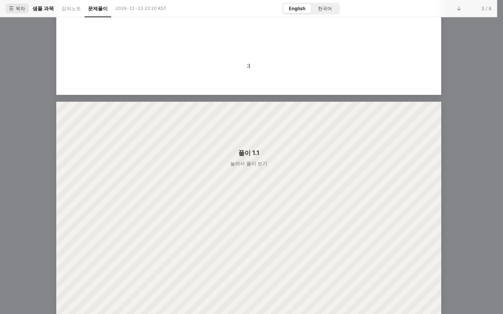
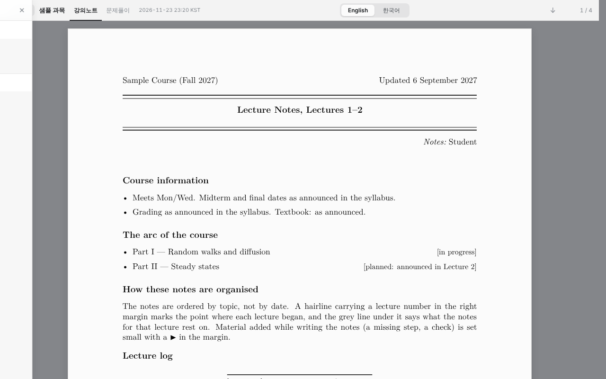
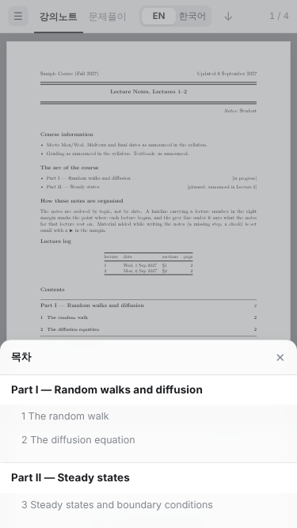

# PDF notes viewer

A single `index.html` (no build step, no framework) that shows a course's PDFs
on the web as a continuous scroll of page images, with an English/Korean
switch that lands on the same section in the other edition, a table of
contents drawn from the PDF bookmarks, optional tabs for further documents (a
problem book), solution pages covered until tapped, remembered reading places,
and a layout that works from a 320px phone to a desktop. It reads a small
`manifest.json` that the publish script writes, so publishing never touches
the viewer.

It was refined over one term on nine course sites, mostly from the student's
complaints ("the toggle jumps", "I lose my place when I switch to Korean",
"rotating the iPad throws me to another page"). Every behaviour below exists
because something went wrong without it.

<p>
  
  
</p>
<p>
  
  
</p>

Screenshots: the sample site of this repository (`assets/test/viewer-test.js
--shots`), placeholder content only.

## When to use

- A notes repository needs its site (`docs/index.html`).
- The student asks for a viewer change: a second document as a tab, covered
  solutions, a layout fix, a behaviour fix.
- Bringing an older course site up to the current viewer.

The PDFs themselves come from `bilingual-lecture-notes` (notes) and
`exam-prep-materials` (problem book); the page listing all courses is
`course-notes-hub`.

## What you get

- `assets/index.html`: the viewer, with a sample course configured
  (`Notes-EN.pdf`/`Notes-KO.pdf` and a problem book `Problems-EN.pdf`/
  `Problems-KO.pdf`), matching the file names of the course template.
- `assets/manifest.example.json`: the manifest it reads.
- `assets/test/viewer-test.js`: a Playwright end-to-end test that runs on any
  course's `docs/` folder (first load, contents, language switch at a
  section, deep links, resize, tabs, veils, phone layout).

## Steps: a new course site

1. Copy `assets/index.html` to the course's `docs/index.html` (or the
   repository root, if Pages serves the root).
2. Edit the **three HTML places** that must work without JavaScript: `<title>`,
   `<meta name="description">`, and the two spans in `#title` (long and short
   course name).
3. Edit the **"과목 설정" (course settings) block** at the top of the script:
   `DOCS` (id, tab label, title, file names per language, `solutions:true` for
   a problem book), `DEFAULT_LANG`, the storage keys `LS_LANG`, `LS_POS`,
   `SS_SOL` with a **prefix unique to this course**, and `MARK` if the problem
   book uses another destination prefix. Nothing else in the file knows which
   course it is. See [configuration.md](references/configuration.md).
4. Make sure `publish.sh` writes `docs/manifest.json` with the page counts
   under the same document ids and copies the PDFs under the same names.
5. `touch docs/.nojekyll`; GitHub Pages from `main` / `docs`.
6. Test locally with `assets/test/viewer-test.js` (below), then publish and
   confirm the Pages run.

## Steps: changing the viewer

1. Change only what the student asked for. The viewer is shared by every
   course; keep the course-settings block the only per-course difference so a
   fix can be copied to every site unchanged.
2. Read [behaviour.md](references/behaviour.md) for the part you touch: most
   lines exist to prevent a specific glitch, and the comments in the file say
   which.
3. Run the test, and look at screenshots at 1280×800 and 375×667 in light and
   dark mode. Check with a slow network if loading behaviour changed.
4. Copy the new file to the other course sites that should get the change,
   keeping each site's settings block. `diff` against the old file: the only
   differences outside the change must be the settings block and the three
   HTML places.
5. Commit as `viewer: …` separately from note updates.

## Testing

```sh
npm pack pdfjs-dist@3.11.174 && tar xzf pdfjs-dist-3.11.174.tgz   # once, if the CDNs are blocked
PDFJS_DIR=$PWD/package node assets/test/viewer-test.js <course>/docs --shots /tmp/shots
```

`all checks passed` is the bar. Details and manual checks in
[testing.md](references/testing.md).

## Rules

- **Never change published section numbering to suit the viewer**, and never
  number parts in the bookmarks: the viewer matches places across editions by
  the leading number of each bookmark ("2.3 Title"), so PDFs need
  `hyperref`'s `bookmarksnumbered` and unnumbered part bookmarks.
- **The two editions must have the same numbered bookmarks in the same order**;
  the build checks it (`labelcheck.py`, `probcheck.py`).
- **Layout never shifts under the reader.** Anything that appears late (date,
  page indicator, contents button, bold tab) reserves its width from the first
  paint. Keep that property when adding anything to the bar.
- **pdf.js version is pinned** (3.11.174, from cdnjs, with CMaps and standard
  fonts from jsdelivr; without CMaps Korean text renders as boxes). Change the
  version in one place and test.
- **Storage keys are per course**: all sites of one GitHub account share the
  origin `<account>.github.io` and therefore one `localStorage`.
- **The publish script owns `manifest.json`;** the viewer has no version
  string of its own.
- **Do not edit the viewer during a note update.**

## Self-check

- [ ] `viewer-test.js` passes on the course's `docs/`.
- [ ] The settings block names files that exist in `docs/` and ids that the
      manifest uses.
- [ ] Storage-key prefix differs from every other course of the account.
- [ ] Screenshots at desktop and phone width look right in both languages.
- [ ] After publishing, the "pages build and deployment" run succeeded.

## References

- [behaviour.md](references/behaviour.md): every behaviour and why it is so:
  loading, rendering, places, language switch, resize, contents, tabs,
  solutions, layout, accessibility.
- [configuration.md](references/configuration.md): the settings block, the
  HTML places, UI strings, the manifest contract, file names.
- [variants-and-history.md](references/variants-and-history.md): the earlier
  variants still deployed and the glitches each fix answered.
- [testing.md](references/testing.md): the automated test, offline pdf.js,
  manual checks, checking a deploy.
